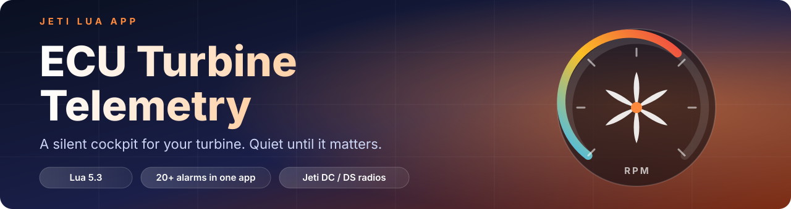
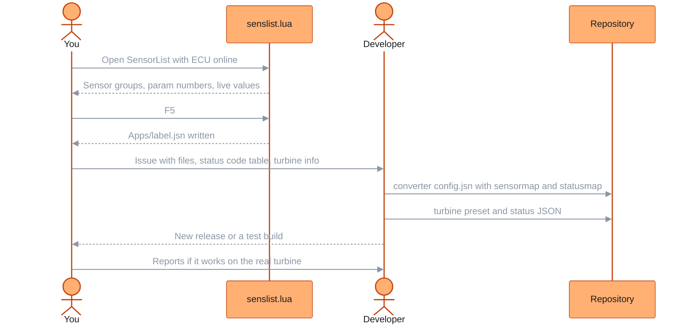
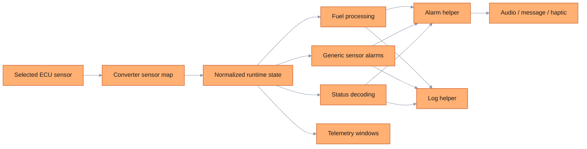
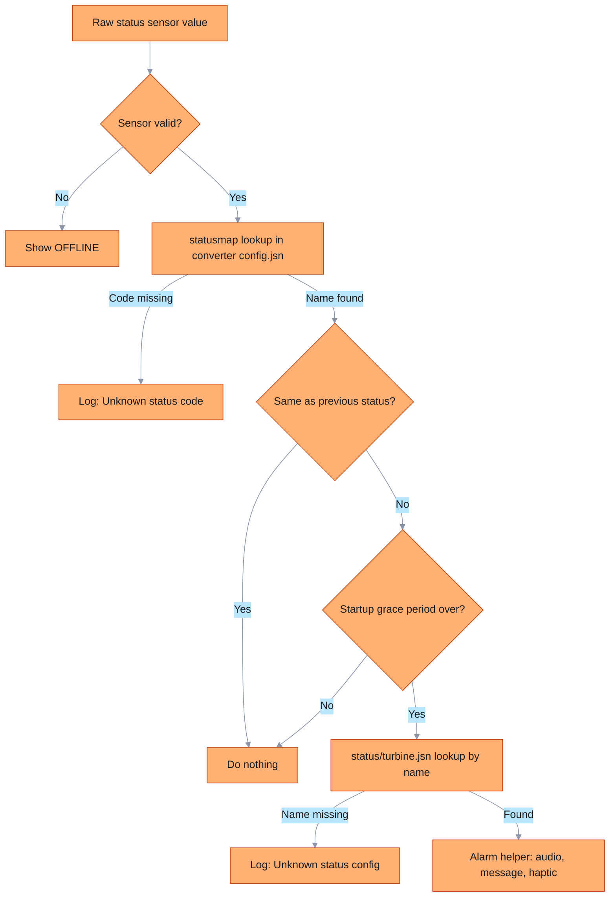
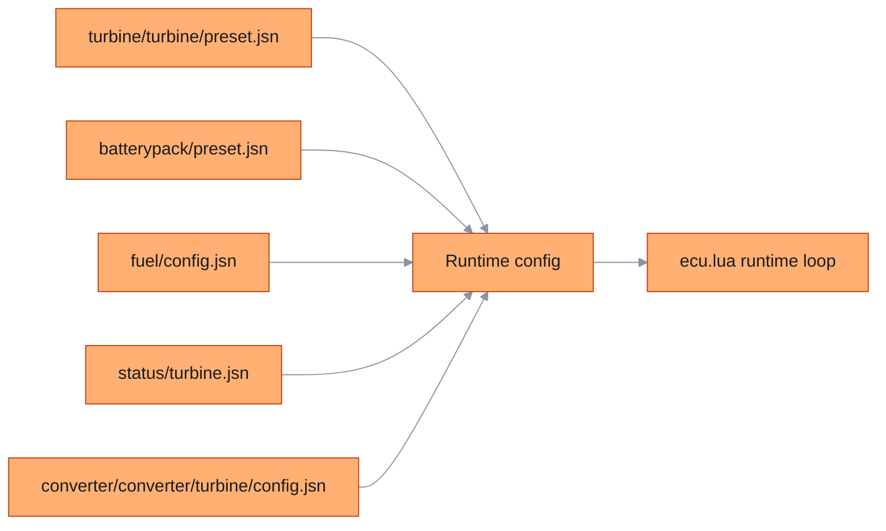
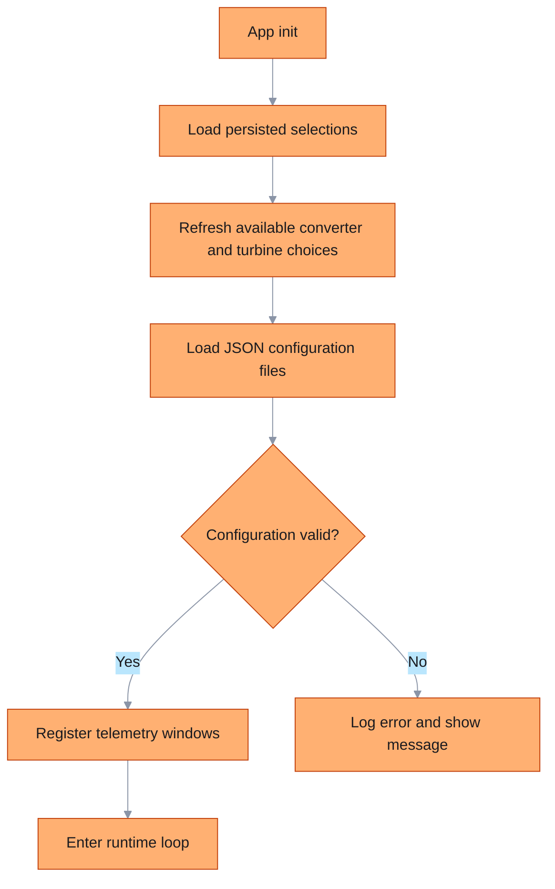
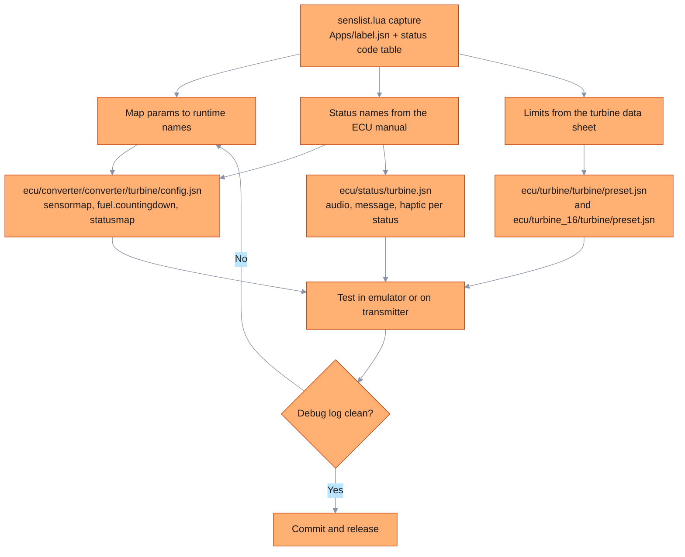

<div align="center">



<p>
  
  
  
  
  
</p>

<p>
  <b>Turbine ECU monitoring, alarm handling and a live dashboard for Jeti transmitters.</b><br>
  RPM &middot; RPM2 &middot; EGT &middot; ECU voltage &middot; pump voltage &middot; fuel &middot; status
</p>

<p>
  <a href="#-quick-start"><b>Quick start</b></a> &nbsp;&bull;&nbsp;
  <a href="#-features"><b>Features</b></a> &nbsp;&bull;&nbsp;
  <a href="#-supported-combinations-grid"><b>Supported turbines</b></a> &nbsp;&bull;&nbsp;
  <a href="#-is-your-turbine-missing-send-feedback-with-senslistlua"><b>Request your turbine</b></a> &nbsp;&bull;&nbsp;
  <a href="#-errors-crashes-and-troubleshooting-on-the-transmitter"><b>Troubleshooting</b></a> &nbsp;&bull;&nbsp;
  <a href="#-technical-reference"><b>Technical reference</b></a>
</p>

<table>
  <tr>
    <td align="center" width="33%">
      <h3>🤫 Silent cockpit</h3>
      No sound, vibration or popup in normal operation. If it speaks, it matters.
    </td>
    <td align="center" width="33%">
      <h3>🚨 20+ alarms in one app</h3>
      One configurable Lua app replaces a pile of per-sensor transmitter alarm setups.
    </td>
    <td align="center" width="33%">
      <h3>📈 Flight-log timeline</h3>
      Every alarm and status change lands on the Jeti log timeline for post-flight analysis.
    </td>
  </tr>
</table>

</div>

## 🤫 Design philosophy: silent (black) cockpit

> [!TIP]
> **A warning always means something real.** In normal operation the app stays **completely silent**: no sounds, no vibration, no popups. It only asks for your attention when an actual **alarm condition** is detected, so you stay focused on flying.

This app is built around a **silent cockpit** (also called a black cockpit) principle:

- 🔇 when everything is normal, the system stays **completely silent**
- 🚨 it only asks for your attention when a real **alarm condition** is detected
- 🎯 every alert is meaningful instead of background noise

On top of that, the app is designed to **replace at least 20 separate transmitter alarm setups** (per-sensor high/low alarms for RPM, shaft RPM, EGT, ECU voltage, pump voltage, the fuel-level thresholds, the fuel-sensor fault, the ECU-offline watchdog, and every named turbine status) with a single, configurable Lua app that has a **graphical dashboard**.

Every alarm is also written to the **Jeti flight log timeline** on the model it runs on, so you can do proper **post-flight analysis** of exactly which alarms fired and when.

## 🚀 Quick start

If you want the shortest path to a working setup:

| Step | Do this |
| :---: | :--- |
| **1** | 📦 Copy `ecu.lc` or `ecu_16.lc` to the transmitter |
| **2** | 📂 Copy the full `ecu/` directory to the transmitter |
| **3** | ➕ Add the ECU app from the transmitter Applications menu |
| **4** | 🎛️ Choose converter family, turbine family, turbine config, battery config, and ECU sensor |
| **5** | ✅ Verify the app starts without `Err` |
| **6** | 🐞 If it shows `Err`, open the debug console and use the log output to find the failing config or sensor mapping |

Your turbine or converter is not in the list? See [Is your turbine missing?](#-is-your-turbine-missing-send-feedback-with-senslistlua) to send the developer the data needed to add it.

## ✨ Features

| | Capability |
| :---: | :--- |
| 🤫 | **Silent cockpit**: stays quiet in normal operation and only alerts on real alarm conditions |
| 📡 | Reads telemetry from a selected ECU sensor source |
| 🔀 | Maps converter-specific parameters into a common runtime format |
| 📋 | Applies turbine-specific alarm and status rules from JSON configuration files |
| 📟 | Renders dedicated telemetry windows for live turbine monitoring |
| ⏳ | Delays alarm activation during startup stabilization (30 s grace after the first full telemetry read) |
| 🔊 | Supports status-driven voice, message, and haptic alerts where available |
| 🔁 | Suppresses repeated alarms with timed cooldown behavior (30 s between repeats) |
| 🧯 | Arms low-value alarms only after a sensor has reported a real reading, so 0.0 startup values never trigger false alarms |
| ⛽ | Handles fuel threshold warnings and critical alerts |
| 📴 | Detects ECU offline conditions after signal loss |
| 📈 | Logs every alarm and status change to the Jeti flight log timeline for post-flight analysis |
| 🪲 | Reports important faults through a shared logger to make debugging easier |

## 🧩 Feature sets

| Feature set | Target | Notes |
| :--- | :--- | :--- |
| `ecu.lua` | Jeti transmitters with more memory | Main full-featured entrypoint |
| `ecu_16.lua` | Older/lower-memory Jeti transmitters | Leaner runtime with reduced feature footprint |
| `ecu.lc` | Compiled install for newer transmitters | Compiled artifact of `ecu.lua` |
| `ecu_16.lc` | Compiled install for older transmitters | Compiled artifact of `ecu_16.lua` |

The root entrypoints above are the active scripts.

## 📡 Supported Jeti transmitters

The `HARDWARE` column in `Apps.csv` controls which transmitters are offered the ECU app in the Jeti App Store. The table below lists all known Jeti transmitter hardware codes and whether the ECU script is currently offered to them.

<details>
<summary><b>Show all Jeti transmitter hardware codes</b></summary>

| Transmitter | Code | Supported |
| :--- | :---: | :---: |
| DC-16 II (V2) | 652 | ✅ |
| DS-16 II (V2) | 653 | ✅ |
| DC-16 | 674 | ➖ |
| DS-16 | 675 | ➖ |
| DS-14 | 676 | ➖ |
| DC-14 | 677 | ➖ |
| DC-24 | 678 | ✅ |
| DS-24 | 679 | ✅ |
| DS-12 | 680 | ➖ |
| DC-14 II (V2) | 3857 | ✅ |
| DS-14 II (V2) | 3858 | ✅ |
| DC-24 (II) | 3859 | ✅ |
| DS-24 (II) | 3860 | ✅ |
| DC-16 II (V2) | 3861 | ✅ |
| DS-16 II (V2) | 3862 | ✅ |
| DC-14 II (V2) | 3863 | ✅ |
| DS-14 II (V2) | 3864 | ✅ |
| DS-12 II | 3865 | ✅ |
| DC-24 II (V2) | 3866 | ✅ |

</details>

Notes:

- ✅ means the code is listed in `Apps.csv` `HARDWARE`, so the app is offered to that transmitter in the App Store.
- ➖ means the code is a known Jeti transmitter but is not currently offered the app.
- Some models share more than one hardware code across firmware generations, which is why several II/V2 radios appear more than once.
- Hardware codes are sourced from the [jemoview](https://github.com/werinza/jemoview) transmitter type-code table.

### Differences between `ecu.lua` and `ecu_16.lua`

| Capability | `ecu.lua` | `ecu_16.lua` |
| :--- | :--- | :--- |
| Telemetry windows | 2 (status/fuel and RPM/EGT/battery) | 1 (status/fuel/battery) |
| RPM2 / shaft RPM | ✅ | ➖ |
| Alarm audio control switch | separate per-channel switch | single on/off switch for all alarms |
| Alarm message control switch | separate per-channel switch | ➖ |
| Alarm haptic control switch | separate per-channel switch | ➖ |
| Alarm config format | nested objects with `audio`, `message`, `haptic` | plain numeric `high` / `low` thresholds |
| Fuel alarms | multi-threshold array with full alarm objects | percentage `warning` and `critical` thresholds |
| Config validation | strict, with logged errors per field | minimal, fails silently |
| Config load protection | `pcall`-guarded | unguarded |
| Centralized logging | `loghelper.lua` (info/warn/error) | `print()` only |
| Helper libraries | external `require` modules | all helpers inlined |
| Transmitter control channel | ➖ | registers a turbine-off control output |
| Config directories | `turbine/`, `batterypack/`, `fuel/` | `turbine_16/`, `batterypack_16/`, `fuel_16/` |

## 📟 Telemetry windows and visualization

The active telemetry presentation is intentionally simple and fast to render on the transmitter.

### Full app: `ecu.lua`

The full app registers **two telemetry windows**.

#### Window 1

Shows the most important in-flight status information:

- **fuel level** on the left
- **turbine status text** at the upper right
- **pump voltage** and **ECU voltage** at the lower right

Visualization:

- fuel is shown as a **vertical segmented gauge** with `F` and `E` markers
- when fuel is critically low, the normal gauge is replaced by a **blinking warning triangle** with the remaining percentage
- turbine status is shown as large text such as normal status, `UNKNOWN`, `UNCONFIG`, `NO CONFIG`, or `OFFLINE`
- pump and ECU voltages are shown as direct numeric voltage readouts

#### Window 2

Shows live engine values and peak values:

- **ECU battery/voltage level** as a gauge on the left
- **RPM** current and maximum values
- **RPM2** current and maximum values
- **EGT** current and maximum values

Visualization:

- ECU voltage is shown as a **vertical segmented battery-style gauge**
- RPM, RPM2, and EGT are shown in a compact **table layout** with `SENS`, `NOW`, and `MAX` columns
- RPM is abbreviated in **thousands** using `K`
- EGT is shown in **degrees C**

### Low-memory app: `ecu_16.lua`

The `-16` version registers **one telemetry window**:

- fuel gauge on the left
- turbine status text on the upper right
- pump and ECU voltage readouts on the lower right

RPM and EGT are not shown in the telemetry window in the low-memory version. The alarm system fires audio and a message box directly using `AUDIO_IMMEDIATE` rather than going through the shared alarm helper.

### Experimental windows

There are additional experimental/legacy window modules in the repository, but they are **not registered by default** in the active runtime.

## 🔌 Supported configuration families

The repository currently contains configuration folders for these converter families:

- `vspeak`
- `digitech`
- `jetcat`
- `kingtech`
- `xicoy`
- `cbelectroniks`
- `ecusimulator`

The turbine profile folders (`ecu/turbine/` and `ecu/turbine_16/`) currently include:

- `amt`
- `behotec`
- `colibri`
- `evojet`
- `graupner`
- `hammer`
- `hornet`
- `jakadofsky`
- `jetcat`
- `kingtech`
- `kingtechg1`
- `kingtechg2`
- `kingtechg3`
- `kingtechg4`
- `kingtechg5`
- `lambert`
- `orbit`
- `pbs`
- `xicoyv6`
- `xicoyv10`
- `xicoyvx`

## 🧮 Supported combinations grid

This grid reflects the current converter-to-turbine combinations present in the repository configuration folders.

| Converter \ Turbine | `amt` | `evojet` | `graupner` | `hammer` | `hornet` | `jakadofsky` | `jetcat` | `kingtech` | `kingtechg1` | `kingtechg2` | `kingtechg3` | `kingtechg4` | `kingtechg5` | `lambert` | `pbs` | `xicoyv6` | `xicoyv10` | `xicoyvx` |
| :--- | :---: | :---: | :---: | :---: | :---: | :---: | :---: | :---: | :---: | :---: | :---: | :---: | :---: | :---: | :---: | :---: | :---: | :---: |
| `cbelectroniks` | ➖ | ➖ | ➖ | ➖ | ➖ | ➖ | ✅ | ➖ | ➖ | ➖ | ➖ | ➖ | ➖ | ➖ | ➖ | ✅ | ✅ | ➖ |
| `digitech` | ➖ | ✅ | ✅ | ✅ | ✅ | ➖ | ✅ | ➖ | ✅ | ✅ | ➖ | ➖ | ➖ | ✅ | ➖ | ✅ | ✅ | ➖ |
| `ecusimulator` | ✅ | ✅ | ➖ | ➖ | ✅ | ✅ | ✅ | ➖ | ➖ | ➖ | ➖ | ➖ | ➖ | ➖ | ✅ | ➖ | ➖ | ➖ |
| `jetcat` | ➖ | ➖ | ➖ | ➖ | ➖ | ➖ | ✅ | ➖ | ➖ | ➖ | ➖ | ➖ | ➖ | ➖ | ➖ | ➖ | ➖ | ➖ |
| `kingtech` | ➖ | ➖ | ➖ | ➖ | ➖ | ➖ | ➖ | ➖ | ✅ | ✅ | ✅ | ✅ | ✅ | ➖ | ➖ | ➖ | ➖ | ➖ |
| `vspeak` | ✅ | ✅ | ➖ | ➖ | ✅ | ✅ | ✅ | ✅ | ➖ | ➖ | ➖ | ➖ | ➖ | ➖ | ✅ | ➖ | ➖ | ➖ |
| `xicoy` | ➖ | ➖ | ➖ | ➖ | ➖ | ➖ | ➖ | ➖ | ➖ | ➖ | ➖ | ➖ | ➖ | ➖ | ➖ | ✅ | ✅ | ✅ |

Notes:

- ✅ means a matching converter/turbine folder combination exists in the repo
- ➖ means there is no matching converter mapping folder currently in the repo
- turbine profile folders `behotec`, `colibri`, and `orbit` exist (with matching status files), but they do not currently appear in any converter-family mapping folder
- some names intentionally differ between converter and turbine families, for example `vspeak -> kingtech` and `kingtech -> kingtechg1`…`kingtechg5`
- the `ecusimulator` converter is a software test source that lets you exercise the app and its alarms without connected ECU hardware
- this grid describes configuration presence in the repo, not a guarantee that every combination has been equally flight-tested

<p align="center"></p>

## 🔧 Is your turbine missing? Send feedback with `senslist.lua`

Support for a turbine is driven entirely by small JSON files (see [Configuration model](#configuration-model)). The one thing the developer cannot guess is **how your converter/ECU exposes its telemetry on Jeti**: which sensor parameter is RPM, which is EGT, and what each numeric status code means. `senslist.lua` captures exactly that from your own transmitter, so you can send it to the developer and get your turbine added without writing any code.

```mermaid
%%{init: {'theme':'base','themeVariables':{'primaryColor':'#ffb072','primaryTextColor':'#1b1b1f','primaryBorderColor':'#c2410c','secondaryColor':'#bae6fd','tertiaryColor':'#e2e8f0','lineColor':'#8b95a7','textColor':'#8b95a7','signalColor':'#8b95a7','signalTextColor':'#8b95a7','actorBkg':'#ffb072','actorBorder':'#c2410c','actorTextColor':'#1b1b1f','noteBkgColor':'#bae6fd','noteTextColor':'#1b1b1f'}}}%%
flowchart LR
    A[Your turbine, ECU and converter] -->|Jeti telemetry| B[Transmitter]
    B --> C[senslist.lua]
    C -->|F5| D["Apps/*.jsn discovery files"]
    D --> E[GitHub issue or email]
    A -.->|status codes noted by hand| E
    E --> F[Developer adds converter, turbine and status JSON]
    F --> G[New turbine selectable in the ECU app]
```



> [!NOTE]
> `senslist.lua` only **reads** telemetry. It never sends commands to the ECU or the turbine.

> [!WARNING]
> Run the turbine only under your normal safety procedures while collecting status codes.

### What you need

- the transmitter with the ECU/converter connected and telemetry visible in the Jeti telemetry sensor list
- `senslist.lua` from this repository
- a way to read files from the transmitter afterwards (SD card reader, USB, or the Jeti Studio file browser)

### Step by step

1. **Copy `senslist.lua`** into the `Apps/` folder on the transmitter (it does not need compiling, and it is only a temporary tool).
2. **Add the app**: Menu → Applications → User applications → add **SensorList**.
3. **Power the ECU and converter first** and check that its sensors show up in the transmitter's telemetry sensor list. `senslist.lua` reads the sensor list **once, when the app starts**. If it later shows `No sensors found`, restart the transmitter (or remove and re-add the app) with the ECU already online.
4. **Open Menu → Applications → SensorList.** Every telemetry group is shown as a `--- header ---` followed by one row per parameter:

   ```text
   P2  EGT        634 °C
   P8  RPM        0 ? rpm
   ```

   - `P<n>` is the sensor **param number** the developer needs
   - a trailing `?` means the sensor is not reporting valid data yet
   - the display only refreshes when you press a key, so press **F1** to update the live values
   - **Up/Down** scrolls when there are more rows than fit on screen
5. **Make the values move.** Turn the turbine over, change throttle, and let the ECU step through its states while you press **F1** and watch the rows. Values that never change, or that stay `?`, tell the developer which parameters your converter does not provide.
6. **Record the status codes by hand, or attach the manufacturer's documentation.** `senslist.lua` shows the raw numeric status value but not its meaning. If the manufacturer of your telemetry sensor or converter publishes a document listing the status codes, attach that instead (or as well) and you can skip the manual table. Otherwise, each time the turbine changes state, write down the number from the status row and the name the ECU or its manual gives that state (for example `9 = Burner on`). Also note error/failure codes if your ECU can produce them safely, for example from its manual or by triggering them on the bench.
7. **Press F5** to save the discovery files. You get one file per sensor group at `Apps/<sensor label>.jsn` (existing files with the same name are overwritten). Press F5 while the turbine is running if you can, so the values and `max` fields in the files are realistic.
8. **Copy the `Apps/*.jsn` files** off the transmitter. Only the files for your ECU/converter sensor group are needed, not unrelated sensors such as RX or battery telemetry.
9. **Send the feedback** (see below).
10. **Remove `senslist.lua`** from the transmitter when you are done to free memory.

### What to send

Open a GitHub issue at <https://github.com/thomasekdahlN/jeti-ecu-telemetry-dashboard/issues> titled `New turbine support: <make> <model>`, and attach the files. If you cannot use GitHub, email the author at thomas@ekdahl.no. Include:

| Item | Example |
| --- | --- |
| Turbine make and model | `Kingtech K-100G4`, `JetCat P100-RX` |
| ECU / converter | `V-Speak`, `Digitech`, `CB Electroniks`, `Xicoy`, own build |
| ECU firmware version, if known | `v2.4` |
| Transmitter model and `ecu.lc` or `ecu_16.lc` | `DS-24 II`, `ecu.lc` |
| The `Apps/<sensor label>.jsn` file(s) from F5 | attached |
| Status code table, or the manufacturer's status code documentation | see below |
| Whether fuel counts **down** (remaining) or **up** (consumed) | `fuel starts at tank size and goes down` |
| Turbine data sheet or manual with limits | RPM min/max, EGT max, pump voltage limits, link or PDF |
| A debug console log, if the ECU app shows `Err` | photo of the CMD screen |

Status code table, one line per state you saw:

```text
Code  ECU says
 -3   Timeout
  0   Off
  3   Cooling
  4   Ready
  9   Burner on
 20   Running
```

If the ECU app is already running with the closest existing turbine and logs `Unknown status code: <n>`, include those `<n>` values too. They are exactly the codes missing from the converter's `statusmap`.

### What the developer does with it



You do not need to understand the JSON. If you would like to add the config yourself, the [technical reference below](#from-senslistlua-output-to-a-converter-config) explains each step.

## 📥 Installation on a transmitter

### Option 1: Install with Jeti Studio

1. Install Jeti Studio.
2. Connect the transmitter to your computer.
3. Open the Lua App Manager in Jeti Studio.
4. Install the ECU app.
5. Copy the matching compiled file to the transmitter:
   - use `ecu.lc` for newer transmitters with more memory
   - use `ecu_16.lc` for older lower-memory transmitters
6. Ensure the `ecu/` asset folder is also present on the transmitter.

### Option 2: Manual file copy

Copy these items to the transmitter application storage:

- `ecu.lc` or `ecu_16.lc`
- the full `ecu/` directory

After that:

1. start the transmitter normally
2. open the Applications menu
3. add the ECU app
4. select converter type, turbine type, turbine config, battery config, and ECU sensor

## 📝 First-time setup on the transmitter

Typical setup steps:

1. choose the converter family
2. choose turbine family
3. choose turbine config preset
4. choose the ECU telemetry sensor
5. set tank size
6. choose battery config
7. assign alarm control switches

Most combinations are designed so you do not need to edit JSON manually.

### Alarm control switches

`ecu.lua` exposes three independent switches in the setup form:

- **Audio off switch** — disables all warning sounds when active
- **Haptic off switch** — disables all vibration alerts when active
- **Message off switch** — disables all popup messages when active

`ecu_16.lua` exposes a single switch:

- **Alarm off switch** — disables all alarms (audio and message) when active

Assigning a switch is optional. If no switch is assigned, alarms are always enabled.

## 📜 Logging and debugging

### Alarm and status logging to the Jeti flight log timeline

Every alarm and status message the app raises is shown as a Jeti message box, which Jeti also records to the **flight log timeline** of the model the app runs on. Because the app follows the silent-cockpit principle, the timeline stays clean during normal operation and only fills with entries when something actually happened.

This makes **post-flight analysis** straightforward: you can scroll the model's log timeline after a flight and see exactly which turbine statuses and alarms occurred, and when, alongside the rest of your recorded telemetry.

### Centralized debug logging

The codebase also includes centralized logging through `ecu/lib/loghelper.lua`.

That means important faults such as these are logged consistently:

- missing config files
- invalid JSON
- missing audio files
- missing sensor mappings
- unknown status codes
- missing status configuration
- offline transition issues

If the app reports `Err` on the transmitter:

1. open the app entry
2. press the transmitter command/debug button
3. capture the debug console output
4. include that output when reporting issues

## 🆘 Errors, crashes, and troubleshooting on the transmitter

### Common error situations

The app now logs important failure paths such as:

- missing config files
- invalid JSON config content
- missing audio files
- missing sensor mappings
- unknown turbine status codes
- missing status configuration
- ECU/sensor offline conditions
- incomplete or invalid runtime configuration

### Where the logs are

Runtime logs are written with `print(...)` through the shared logger and appear in the transmitter's **application debug / command console**.

They are also available through Jeti logging, so the log messages can be reviewed later when you analyze recorded telemetry data.

If the app shows `Err` or appears to fail during startup:

1. open the transmitter **Applications** menu
2. highlight the ECU app
3. press the **CMD / command** button
4. read or photograph the displayed debug log

Typical log lines look like this:

- `[ECU][ERROR][validateConfig] Missing converter sensor map`
- `[ECU][ERROR][loadhelper.fileJson] File not found: ...`
- `[ECU-16][WARN][processStatus] Unknown status code: ...`

### How to solve transmitter startup failures or crashes

<details>
<summary><b>Open the 10-step startup checklist</b></summary>

Use this checklist in order:

1. **Confirm the correct compiled file is installed**
   - newer transmitters: `ecu.lc`
   - older/lower-memory transmitters: `ecu_16.lc`

2. **Confirm the full `ecu/` asset folder was copied**
   - missing JSON, locale, or audio files can break startup or leave the app unusable

3. **Open the debug console log**
   - the first `ERROR` line usually points to the failing file, sensor map, or status config

4. **Re-copy the app files if the update may have been partial**
   - replace both the compiled file and the `ecu/` directory together

5. **Check the selected configuration on the transmitter**
   - verify converter family, turbine family, turbine config, battery config, and ECU sensor were selected correctly

6. **If the app says `NO CONFIG` or `UNCONFIG`**
   - reopen setup and select the missing configuration items again
   - verify that the chosen converter/turbine combination actually exists in the repo-supported config set

7. **If the app says `OFFLINE`**
   - the app started, but the expected telemetry is not currently valid
   - verify the ECU is powered, the converter is connected, and the correct telemetry sensor was selected

8. **If the log mentions missing or invalid JSON**
   - re-copy the affected configuration files
   - if you customized JSON manually, validate the syntax and restore a known-good file if needed

9. **If the log mentions missing audio files**
   - re-copy the `ecu/audio/` content or the full `ecu/` folder

10. **If the app still crashes after a clean copy**
    - remove the app entry from the transmitter
    - copy the files again
    - add the app again
    - collect a fresh debug log before changing other settings

</details>

### Best way to report a crash

When reporting a transmitter crash or startup failure, include:

- transmitter model
- whether you used `ecu.lc` or `ecu_16.lc`
- selected converter family
- selected turbine family/config
- a photo or screenshot of the **CMD/debug console log**
- whether the app showed `Err`, `NO CONFIG`, `UNCONFIG`, or `OFFLINE`

## 🎬 Legacy videos

| | Video |
| :---: | :--- |
| ▶️ | [Installation and setup](https://youtu.be/tsEkAW4Y2tU) |
| ▶️ | [Normal usage simulation](https://youtu.be/evyAzlbLs68) |
| ▶️ | [Alarm-heavy flight simulation](https://youtu.be/_tN6GDu43rU) |
| ▶️ | [ECU simulator test rig](https://youtu.be/EmGTHrpVQJE) |

## 📸 Screenshots

Representative screenshots from installation, alarms, and telemetry presentation:

<table>
  <tr>
    <td align="center" width="50%"><br><sub>alarm - ecu offline</sub></td>
    <td align="center" width="50%"><br><sub>gui - configuration</sub></td>
  </tr>
  <tr>
    <td align="center" width="50%"><br><sub>alarm - rc off</sub></td>
    <td align="center" width="50%"><br><sub>alarm - shaft rpm low</sub></td>
  </tr>
  <tr>
    <td align="center" width="50%"><br><sub>display - ecu battery and fuel indicators</sub></td>
    <td align="center" width="50%"><br><sub>display - ecu offline</sub></td>
  </tr>
  <tr>
    <td align="center" width="50%"><br><sub>install - application added and running</sub></td>
    <td align="center" width="50%"><br><sub>install - debug info after pressing the command button</sub></td>
  </tr>
</table>

<p align="center"></p>

## 🧠 Technical reference

### Runtime architecture



### Status decoding

Raw numeric ECU status codes are turned into named statuses in two lookups. This is why a new turbine usually needs both a converter `statusmap` and a matching `status/<turbine>.jsn`:



### Configuration assembly



`ecu_16.lua` uses the `turbine_16/`, `batterypack_16/`, and `fuel_16/` folders plus the same converter config, and takes its status alert behavior from the turbine `_16` preset instead of `status/<turbine>.jsn`. Its status decoding also shows `Status <n>` for an unmapped code instead of logging an error.

### Startup flow



### Configuration model

The app is built around configuration files instead of per-user code edits.

At startup, the selected combination is assembled from:

- converter config in `ecu/converter/.../config.jsn`
- turbine config in `ecu/turbine/.../*.jsn` or `ecu/turbine_16/.../*.jsn`
- battery config in `ecu/batterypack/*.jsn` or `ecu/batterypack_16/*.jsn`
- fuel config in `ecu/fuel/config.jsn` or `ecu/fuel_16/config.jsn`
- status config in `ecu/status/*.jsn`
- locale config in `ecu/locale/*.jsn`

`ecu.lua` uses the full `turbine/`, `batterypack/`, and `fuel/` schemas. `ecu_16.lua` uses the reduced `turbine_16/`, `batterypack_16/`, and `fuel_16/` schemas to save memory.

The menus on the transmitter are filesystem-driven:

- converter menu = folders in `ecu/converter/`
- turbine menu = folders inside `ecu/converter/<converter>/`
- turbine config menu = `.jsn` files in `ecu/turbine/<turbine>/` or `ecu/turbine_16/<turbine>/`
- battery menu = `.jsn` files in `ecu/batterypack/` or `ecu/batterypack_16/`

This means a new turbine will not appear in setup unless the expected folders and files exist in the right places.

All `.jsn` files are parsed as strict JSON. Keep them strict:

- no trailing commas
- no comments inside JSON
- quoted keys and string values
- matching braces and brackets

> [!CAUTION]
> One malformed `.jsn` file is enough to break startup or leave the app in an unusable configuration.

### From `senslist.lua` output to a converter config

This section is for contributors who want to turn a `senslist.lua` capture into repository config files. If you only want to **request** support, follow [Is your turbine missing?](#-is-your-turbine-missing-send-feedback-with-senslistlua) instead.

#### What `senslist.lua` does

- reads all telemetry sensors from `system.getSensors()` once at app start (GPS-type sensors, types 5 and 9, are skipped because their values are not numeric)
- polls live values via `system.getSensorByID()` every loop cycle
- displays all sensor groups and their parameters in the **Applications menu** (Menu → Applications → SensorList), 8 rows at a time
- shows `param`, `label`, live value, unit, and a `?` indicator for sensors not yet reporting valid data
- redraws the form on any key press, so **F1** refreshes the live values and **Up/Down** scrolls
- on **F5**: writes one valid JSON discovery file per top-level sensor group to `Apps/<sensor-label>.jsn`, overwriting any existing file
- prints a summary to the debug console

#### What it does not do

- it does not generate a finished runtime config for `ecu/`
- it does not discover the meaning of each numeric ECU status code
- it does not replace testing on live telemetry or in the emulator

#### Output file format

Each `Apps/<sensor-label>.jsn` contains the full descriptor and last-polled live values for every sub-sensor in that group:

```json
{
    "id"      : 12345,
    "label"   : "Vspeak",
    "sensors" : {
        "EGT" : {
            "param"    : 2,
            "unit"     : "°C",
            "type"     : 1,
            "decimals" : 0,
            "value"    : 634.0,
            "max"      : 856.0,
            "valid"    : true
        }
    }
}
```

> [!IMPORTANT]
> This file is a discovery record only. It is not a finished `ecu/converter/` config file and must not be copied directly into `ecu/`.

#### Recommended workflow



1. collect the capture as described in [Is your turbine missing?](#-is-your-turbine-missing-send-feedback-with-senslistlua), or receive it from a user
2. note the top-level sensor label and each child parameter
3. translate child labels into ECU app runtime names:
   - `rpm` — turbine RPM
   - `rpm2` — shaft RPM or secondary RPM
   - `egt` — exhaust gas temperature
   - `pumpv` — pump voltage
   - `ecuv` — ECU battery voltage
   - `fuel` — remaining or consumed fuel
   - `status` — raw numeric ECU status code
4. create or update `ecu/converter/<converter>/<turbine>/config.jsn` with the discovered `param` numbers, and set `fuel.countingdown` according to whether the fuel value falls or rises during a run
5. build `statusmap` from the numeric status codes the user reported (a status code that is missing here is logged as `Unknown status code`)
6. create or update the matching turbine, status, battery, and fuel JSON files
7. test in the emulator or on the transmitter and watch the debug log for missing keys, unknown statuses, or missing files
8. ask the reporter to confirm on their real turbine before releasing

A fragment of a `senslist.lua` capture and the config it leads to:

```text
senslist.lua row            config.jsn sensormap
P2  EGT      634 °C     ->  "egt"    : "2"
P8  RPM    41200 rpm    ->  "rpm"    : "8"
P1  Status     4        ->  "status" : "1"   and   "statusmap": { "4": "Ready" }
```

The ECU app stores the selected top-level sensor `id` when the user picks the ECU sensor in setup. Configuration authors normally only need the `param` numbers from `senslist.lua`.

In practice:

- if a turbine uses an existing converter layout with the same status naming, you may only need new presets under `ecu/turbine/` and `ecu/turbine_16/`
- if the telemetry layout or status codes differ, you also need a new `ecu/converter/<converter>/<turbine>/config.jsn`
- if the named statuses differ, you also need a matching `ecu/status/<turbine>.jsn`

### JSON file reference

<details>
<summary><b>Show all JSON file schemas</b></summary>

#### `ecu/converter/<converter>/<turbine>/config.jsn`

Purpose:

- maps converter-specific telemetry params into the common runtime names
- tells the fuel helper whether the raw fuel value counts down or up
- translates raw numeric status codes into named statuses

Expected keys:

- `sensormap`
  - object keyed by runtime sensor name
  - values are Jeti `param` numbers, usually stored as strings
  - use `0` or omit a key if a sensor is not provided by the converter
- `fuel.countingdown`
  - `true` when the ECU reports remaining fuel directly
  - `false` when the ECU reports consumed fuel and the app must calculate fuel remaining
- `statusmap`
  - object keyed by raw numeric status codes as strings
  - values are human-readable status names

Common `sensormap` keys are:

- `rpm`
- `rpm2`
- `egt`
- `pumpv`
- `ecuv`
- `fuel`
- `status`

#### `ecu/turbine/<turbine>/*.jsn`

Purpose:

- defines full-version turbine sensor thresholds and alarm behavior for `ecu.lua`

Typical top-level keys are:

- `rpm`
- `rpm2`
- `egt`
- `pumpv`

Each sensor block uses this shape:

- `sensorname`
- `high`
- `low`

Each `high` and `low` block contains alarm metadata such as:

- `text` - human-readable alarm label used when the warning is presented, for example `EGT high` or `RPM low`
- `value` - numeric threshold that triggers the alarm
- `message.enable` - enables or disables the Jeti popup message for that threshold
- `message.seconds` - how long the popup message stays visible
- `audio.enable` - enables or disables playback of the configured warning sound
- `audio.file` - `.wav` file to play from `Apps/ecu/audio/`
- `haptic.enable` - enables or disables transmitter vibration for that threshold
- `haptic.stick` - which side should vibrate, typically `left` or `right`
- `haptic.vibrationProfile` - Jeti vibration pattern/profile number used for the haptic alert

The intended operating model is a **silent cockpit**: in normal operation the app should stay quiet from sound and vibration, and only produce audio/haptic alerts when a real warning, failure, or other meaningful abnormal condition occurs. Normal running states can still use text messages when useful, but audio and vibration should remain reserved for real issues.

These files normally cover turbine-specific limits only. Battery, fuel, and status behavior are merged in from separate JSON files.

#### `ecu/turbine_16/<turbine>/*.jsn`

Purpose:

- defines the reduced threshold schema used by `ecu_16.lua`

Schema difference from the full version:

- uses plain numeric `high` and `low` values instead of nested alarm objects
- typically includes `rpm`, `rpm2`, `egt`, `pumpv`, and `status`
- `status` usually only needs `sensorname`

#### `ecu/batterypack/*.jsn`

Purpose:

- defines ECU battery alarm thresholds and actions for the full app

Available presets cover several chemistries and cell counts:

- `lipo-1s` … `lipo-6s`
- `life-1s` … `life-6s`
- `a123-1s` … `a123-6s`
- `nicd-06s` … `nicd-12s`

Schema:

- same general alarm-block structure as the full turbine sensor files
- `sensorname` is normally `ecuv`
- includes metadata such as `type` and `cells`

The `ecu/batterytype/` folder holds per-chemistry voltage-to-percentage reference data (`a123`, `life`, `lipo`, `nicd`, `nimh`).

#### `ecu/batterypack_16/*.jsn`

Purpose:

- defines simplified ECU battery thresholds for the low-memory app

Ships a reduced subset of presets (for example `lipo-2s`…`lipo-4s`, `life-2s`…`life-4s`, `a123-2s`…`a123-4s`, and `nicd-10s`) to save memory.

Schema:

- `sensorname`
- `type`
- `cells`
- numeric `high`
- numeric `low`

#### `ecu/fuel/config.jsn`

Purpose:

- defines full-version fuel handling and fuel alarms

Keys:

- `sensorname`
- `tanksize`
- `unit`
- `sensorproblem`
- `alarms`

`alarms` is an array of alarm objects. Keep the array ordered from the lowest remaining-fuel threshold to the highest threshold, because the runtime uses the first threshold that matches.

`fuelhelper` combines this file with `converter.fuel.countingdown` to decide whether the raw fuel value represents remaining fuel or consumed fuel.

#### `ecu/fuel_16/config.jsn`

Purpose:

- defines the low-memory fuel display and warning thresholds

Keys:

- `sensorname`
- `tanksize`
- `decimals`
- `unit`
- `label`
- `warning`
- `critical`

#### `ecu/status/<turbine>.jsn`

Purpose:

- defines what the app should do when the ECU enters a named status

Schema:

- top-level `sensorname` is `status`
- every other top-level key is a named ECU status such as `Run`, `Off`, `Failure`, or `Accelerate`
- each status entry defines `text`, `message`, `audio`, and `haptic` behavior

The values in `converter/.../config.jsn -> statusmap` should match these status keys exactly. If they do not match, the app logs the status as unknown or missing configuration.

#### `ecu/locale/<language>.jsn`

Purpose:

- stores translated UI text

Used for:

- app name
- setup menu labels
- telemetry window titles
- switch labels

The app first tries `system.getLocale()` and then falls back to `ecu/locale/en.jsn`.

Supported languages:

| File     | Language          |
| -------- | ----------------- |
| `en.jsn` | English (default) |
| `de.jsn` | German            |
| `es.jsn` | Spanish           |
| `fr.jsn` | French            |
| `it.jsn` | Italian           |
| `no.jsn` | Norwegian         |

Each locale file is a flat JSON object with the same 13 keys:

- `appName` - application name shown in the transmitter menu
- `window1`, `window2` - telemetry window titles
- `selectConverterType`, `selectTurbineType`, `selectTurbineConfig`, `selectBatteryConfig`, `selectTurbineSensor`, `selectLeftTurbineSensor` - setup menu labels
- `alarmOffSwitch`, `AudioOffSwitch`, `HapticOffSwitch`, `MessageOffSwitch` - switch labels

Technical tokens (`ECU`, `RPM`, `EGT`, `volt`) and the product name `ECU Dashboard` are kept consistent across all languages.

To add a new language:

1. Copy `ecu/locale/en.jsn` to `ecu/locale/<code>.jsn`, where `<code>` is the two-letter code returned by `system.getLocale()` on your transmitter.
2. Translate the values only; do not rename, add, or remove keys.
3. Keep every file at the same 13 keys so the interface stays complete in all languages.

</details>

### Minimal file set when adding support

For a new full-version converter/turbine combination, the usual minimum is:

- `ecu/converter/<converter>/<turbine>/config.jsn`
- `ecu/turbine/<turbine>/<preset>.jsn`
- `ecu/status/<turbine>.jsn`

For the low-memory version, add:

- `ecu/turbine_16/<turbine>/<preset>.jsn`

Usually you can reuse the shared battery and fuel presets unless the converter requires a genuinely different battery or fuel interpretation.

If you want the same turbine family to be selectable in both active entrypoints, keep `ecu/turbine/<turbine>/` and `ecu/turbine_16/<turbine>/` aligned.

### Repository layout

```text
.
├── ecu.lua                # Main full-featured entrypoint
├── ecu_16.lua             # Lower-memory entrypoint
├── ecu.lc                 # Compiled app for newer transmitters
├── ecu_16.lc              # Compiled app for older transmitters
├── senslist.lua           # Sensor discovery utility (temporary app)
├── docs/                  # Jeti Lua API documentation
├── ecu/
│   ├── audio/             # Alarm/status audio files (168 .wav files)
│   ├── batterypack/       # Battery config for full app
│   ├── batterypack_16/    # Battery config for low-memory app
│   ├── batterytype/       # Battery chemistry voltage/percentage reference data
│   ├── converter/         # Converter-specific sensor/status mapping
│   ├── fuel/              # Fuel config for full app
│   ├── fuel_16/           # Fuel config for low-memory app
│   ├── lib/               # Shared helpers used by entrypoints
│   ├── locale/            # Language files (de, en, es, fr, it, no)
│   ├── status/            # Turbine status definitions
│   ├── turbine/           # Turbine profiles for full app
│   └── turbine_16/        # Turbine profiles for low-memory app
└── pack_for_jeti_appstore.sh  # Packaging helper for app-store archive
```

### Shared helper modules

Important helpers under `ecu/lib/`:

- `alarmhelper.lua` - audio, message, and haptic alarm dispatch
- `drawhelper.lua` - shared telemetry drawing helpers
- `fuelhelper.lua` - fuel calculations and threshold helpers
- `loadhelper.lua` - JSON/file loading helpers
- `loghelper.lua` - centralized `info`, `warn`, and `error` logging
- `sensorhelper.lua` - sensor discovery/menu helpers
- `tablehelper.lua` - directory/file-backed selection list helpers
- `window1.lua` and `window2.lua` - active telemetry window renderers
- `window3.lua` and `window4.lua` - experimental/full-screen window renderers, not registered by default
- `ecuvhelper.lua` - placeholder module reserved for future ECU-voltage helpers
- `fakesensor.lua` - development-only fake sensor source for testing without live telemetry (its `require` is commented out in the entrypoints)

### Local development

<details>
<summary><b>Toolchain and validation commands</b></summary>

#### Lua version

This project targets **Lua 5.3** behavior, matching the Jeti Lua environment documented in `docs/JETIDCDS_Lua_API_1.5.pdf`.

#### Recommended macOS tooling

Install local tools with Homebrew:

```bash
brew install lua stylua luacheck
lua -v
luac -v
stylua --version
luacheck --version
```

#### Useful validation commands

Run syntax checks on the active entrypoints and key helpers:

```bash
luac -p ecu.lua
luac -p ecu_16.lua
luac -p ecu/lib/loadhelper.lua
luac -p ecu/lib/alarmhelper.lua
luac -p ecu/lib/loghelper.lua
```

Run linting if `luacheck` is installed:

```bash
luacheck ecu.lua ecu_16.lua ecu/lib
```

Format code when you want a formatting pass:

```bash
stylua ecu.lua ecu_16.lua ecu/lib
```

</details>

### Packaging

The repository includes helper script for preparing a Jeti app-store style archive:

- `pack_for_jeti_appstore.sh`

This script collects the compiled `.lc` files, the `ecu/` assets, and supporting metadata into a distributable archive.

### External documentation

- Jeti Lua API PDF: `docs/JETIDCDS_Lua_API_1.5.pdf`
- Jeti website: http://jetimodel.com/

### Contributing

Useful contributions include:

- testing on additional ECU converters and turbines
- validating alarm thresholds and best-practice presets
- improving translations in `ecu/locale/`
- reporting reproducible debug logs from transmitter or emulator runs

When changing code, keep these priorities in mind:

- memory usage matters
- stability matters more than clever abstractions
- `ecu.lua` and `ecu_16.lua` must remain intentionally separate entrypoints
